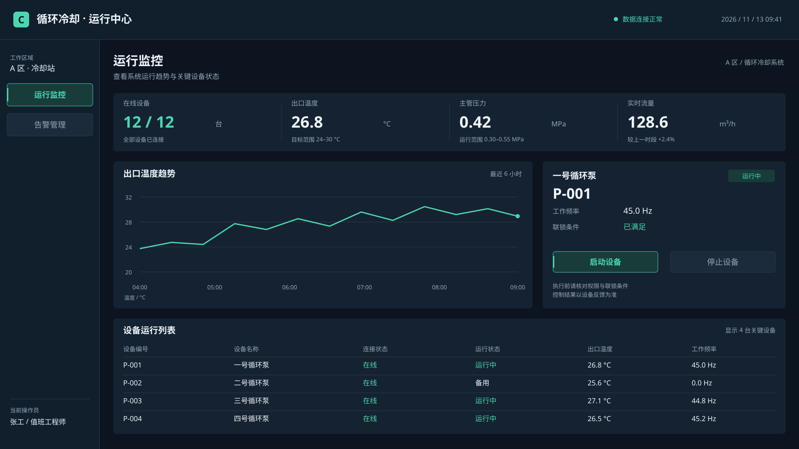
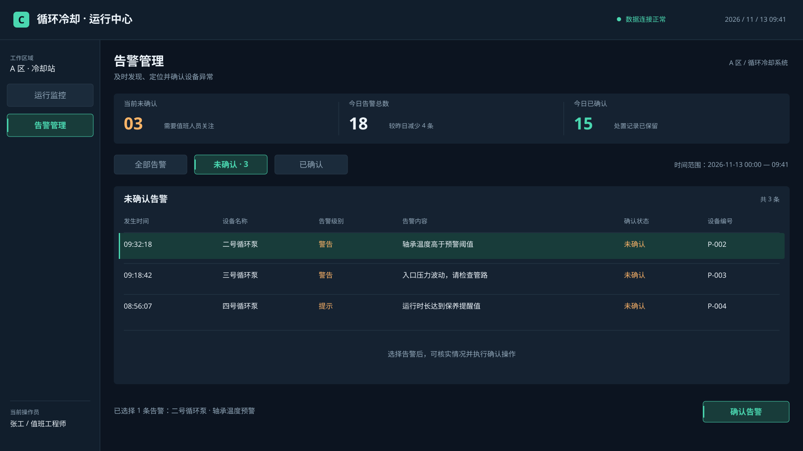

# UIToPE · 技术协议转 UI

把技术协议中的系统功能转为可编辑、按界面元素分组的 SVG 设计，并导出独立高分辨率素材。

**同事试用：下载仓库，在 Codex 中打开仓库根目录，提供协议，说一句「把这份协议生成 UI」。** 尺寸、分组、命名、按钮状态和报告要求已经封装在 Skill 中，不用再复制长提示词。

## 快速开始

1. 点击 GitHub 的 **Code → Download ZIP** 并解压，或运行：

   ```sh
   git clone https://github.com/anewlearner256/UIToPE.git
   cd UIToPE
   ```

2. 在支持读取 `AGENTS.md` 的 Codex 环境中打开 **UIToPE 仓库根目录**。根目录入口会将协议转 UI 和客户反馈修改任务指向 [protocol-to-ui Skill](skills/protocol-to-ui/SKILL.md)。

3. 上传技术协议，或提供本机文件路径，然后说：

   > 把这份协议生成 UI。

   后续提供截图或修改意见即可，例如：

   > 把启动设备按钮的选中颜色改为橙色，生成新版本。

首次运行需要 Python 3.10+ 和 Node.js 18+；PNG 渲染依赖可以由代理根据 Skill 在本地安装。已在 Windows 和 Microsoft YaHei 字体环境验证。其他系统需要安装可用中文字体，并调整设计源中的 `font_family` 后检查排版。

如果所用代理不读取 `AGENTS.md`，只需告诉它一次：读取 `skills/protocol-to-ui/SKILL.md` 并使用该流程；无需复述导出规范。

## 默认交付

| 项目 | 规则 |
|---|---|
| 页面 SVG | 固定 1920 × 1080 |
| 分组 | 页面 → 功能区域 → 界面元素 → 状态及内部内容 |
| 可编辑内容 | 文字保留为 text，图形与内部结构保留分组 |
| 独立素材 | 按内容命名，同时导出 SVG 和 3x PNG |
| 按钮 | 分别导出选中、未选中两种状态，尺寸一致 |
| 报告 | 页面预览、需求映射、素材清单、检查报告 |
| 后续修改 | 稳定元素 ID、版本检查、新版本目录，保留已有成果 |

没有指定输出目录时，默认写入 `projects/项目名称/`。该目录已在 Git 忽略规则中。

协议理解与界面设计由执行 Skill 的模型完成；本地脚本负责文字提取、结构检查、SVG 生成、PNG 渲染和版本补丁。运行脚本本身不会自动理解协议，也不需要额外配置模型 API Key。

## 示例预览

以下为虚构的循环冷却系统示例，包含 2 页、34 组独立 SVG/PNG 素材及 10 个按钮。

### 运行监控



### 告警管理



[示例技术协议](skills/protocol-to-ui/assets/示例技术协议.md) · [结构化设计源](skills/protocol-to-ui/assets/example.design.json) · [客户修改示例](skills/protocol-to-ui/assets/example.feedback.json)

## 手动运行示例

以下命令均在仓库根目录执行。首次安装渲染依赖：

```sh
npm --prefix skills/protocol-to-ui ci --ignore-scripts
```

如需提取 PDF，或运行包括 PDF 在内的完整测试，安装 Python 依赖：

```sh
python -m pip install -r skills/protocol-to-ui/requirements.txt
```

生成示例交付：

```sh
python skills/protocol-to-ui/scripts/ui.py validate skills/protocol-to-ui/assets/example.design.json
python skills/protocol-to-ui/scripts/ui.py build skills/protocol-to-ui/assets/example.design.json --out projects/demo/delivery-v1 --scale 3
python skills/protocol-to-ui/scripts/ui.py check skills/protocol-to-ui/assets/example.design.json --out projects/demo/delivery-v1
```

`delivery-v1` 必须是新目录；重复试用时换成新的目录名。页面 PNG 为 5760 × 3240，独立素材按自身逻辑尺寸加透明留白的 3 倍导出。

模拟客户修改：

```sh
python skills/protocol-to-ui/scripts/ui.py patch skills/protocol-to-ui/assets/example.design.json skills/protocol-to-ui/assets/example.feedback.json --out projects/demo/design.v2.json
python skills/protocol-to-ui/scripts/ui.py build projects/demo/design.v2.json --out projects/demo/delivery-v2 --scale 3
```

运行完整测试：

```sh
python -m unittest discover -s skills/protocol-to-ui/tests -v
```

## 输入及当前边界

- 文字提取支持 TXT、Markdown、DOCX 和文字 PDF。扫描页会标记为需要 OCR；截图、图纸、复杂表格需要模型进行视觉检查。
- 当前完整验证的是 SVG 路线。SVG 分组便于编辑；导入 Figma 后的图层不等同于原生组件库。
- [Figma 交付流程](skills/protocol-to-ui/references/figma.md)需要已连接、具备写入能力的官方集成；本仓库未包含 Figma 账号连接，尚未验证账号内写入。
- 示例是静态设计，不会连接设备或执行控制。实际项目的权限、联锁、异常状态等由协议决定。

## 目录

```text
AGENTS.md                      对话任务入口
skills/protocol-to-ui/
  SKILL.md                     默认流程与交付规范
  scripts/                     提取、生成、导出、检查、修改
  references/                  设计契约及 Figma 路线
  assets/                      虚构示例协议、设计源、修改意见
  tests/                       16 项回归测试
docs/previews/                 可编辑 SVG 示例预览
projects/                     本机生成的项目，Git 忽略
```

试用反馈可在 [Issues](https://github.com/anewlearner256/UIToPE/issues) 中说明操作系统、Python/Node 版本、复现步骤与错误信息。
